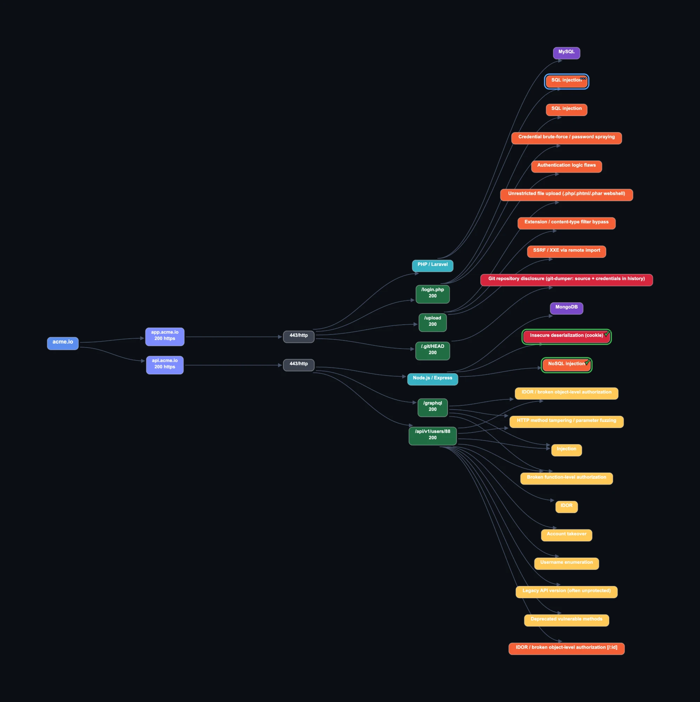

# Korvex

A modular web-reconnaissance toolkit that fingerprints a target's technology
stack, ingests content-discovery and port-scan results, correlates every finding
into **prioritised, stack-aware attack hypotheses**, and renders the whole picture
as an interactive attack graph.

Korvex runs its own HTTP recon (stack fingerprinting and passive discovery) and
**consumes the output of the scanners you already use** (`nmap`, `feroxbuster`,
`ffuf`, `subfinder`) — you run them with any flags you like, Korvex normalises and
correlates their output. A rule-based correlation layer (**~800 keyword, parameter
and cookie mappings**) turns raw findings ("here is a path, here is a header") into
prioritised leads, refined by the detected stack — `/compose` on a Flask app →
*server-side template injection via Jinja2*.

Think of it as Grafana for pentest recon: the tools produce the data, Korvex
correlates and visualises it. Pure Python, one runtime dependency (`requests`);
every stage writes JSON, so the pipeline composes freely.



*Interactive attack graph (demo data): root domain → subdomains → ports → stacks →
paths → prioritised, stack-aware vulnerability leads.*

---

## Highlights

- **Rule-based correlation** — path/parameter/cookie/header/port mapping tables
  (~800 entries) turn findings into prioritised hypotheses (CRITICAL → LOW), each
  with its own hand-assigned severity. Paths are substring-matched; a small
  stack×vuln lookup table refines generic leads for the detected stack.
- **Stack-aware** — a hypothesis is refined by the detected stack: SSTI → Jinja2
  (Python) / Twig (PHP) / Freemarker (Java); file upload → `.php`/`.jsp`/`.aspx`;
  SQLi → NoSQL (Node).
- **Vuln-class signals** — SSRF/OAuth parameters and functional endpoints
  (`/oauth/authorize`, `/soap`, `/graphql`, `/webhook`) map to SSRF/XXE/OAuth/
  deserialization leads. Two signals static rules can't express are probed live:
  **permissive CORS** (reflected/`null`/`*` origin with credentials) and
  **serialized objects in cookies** (PHP `O:`, Java `rO0`, pickle, `__VIEWSTATE`).
- **Low-noise by design** — probes that only echo a host's catch-all status
  (soft-404 / blanket-auth, detected by status code) are suppressed, path-specific
  findings are evidence-gated on the path actually being present, auth-gated routes
  are separated, and unsignatured noise collapses into a single hub node.
- **Sensible defaults** — http/https autodetected per port and nmap service;
  `--proxy` / `-H` / `--cookie` for Burp and authenticated recon.
- **Interactive attack graph** — one dependency-free HTML file: pan/zoom, drag,
  per-node status, hide/collapse, swimlanes, search/filter, notes, a Markdown
  kill-chain report and PNG export. State persists in `localStorage`.

---

## Install

```bash
git clone https://github.com/dripentest/korvex.git
cd korvex
pip install -r requirements.txt        # only: requests
```

**Requirements**

- Python 3.10+
- `requests`
- No external binary is required to run Korvex itself (`fingerprint` / `passive`
  use `requests`). To feed in scan data, run your own tools and import their
  output: [`nmap`](https://nmap.org),
  [`feroxbuster`](https://github.com/epi052/feroxbuster),
  [`ffuf`](https://github.com/ffuf/ffuf),
  [`subfinder`](https://github.com/projectdiscovery/subfinder)

Optional alias so it runs from anywhere:

```bash
alias korvex='python3 /path/to/korvex/main.py'
```

---

## Quick start

```bash
# Korvex's own live recon
korvex fingerprint --target target.thm --port 80,443            # stack, CORS, vulns
korvex passive     --target target.thm --port 80                # robots/sitemap/JS leads

# run your own scanners with any flags, then import their output
nmap -sV -sC -oX s.xml target.thm
korvex nmap --from-xml s.xml --target target.thm
feroxbuster -u http://target.thm:80 -w wordlist.txt --json -o fx.json
korvex dirs --from-ferox fx.json --target target.thm --port 80

# merge everything into one attack graph
korvex graph --target target.thm --no-fingerprint \
           --nmap-json target.thm/target.thm.nmap.json \
           --dirs-json target.thm/target.thm-80.dirs.json \
           --fingerprint-json target.thm/target.thm-80.fp.json
```

Each run writes JSON into a per-target folder (`target.thm/`); `graph` merges
those artifacts into `target.thm/target.thm.graph.html` — open it in any browser.

---

## Commands

| Command | What it does |
|---------|--------------|
| `fingerprint` | **live** — stack · DB · WAF · CORS · deserialization · sensitive paths |
| `passive` | **live** — robots/sitemap paths + endpoints & secrets from linked JS |
| `nmap` | import an nmap `-oX` file → JSON |
| `dirs` | import a feroxbuster `--json` file → JSON |
| `vhost` | import an ffuf `-of json` file → JSON |
| `subs` | liveness-check a list of subdomain names (resolve + HTTP probe) |
| `graph` | merge saved artifacts into an interactive attack graph |

`fingerprint` and `passive` make their own HTTP requests (no external tool). The
other commands **consume** a scan you ran yourself (`--from-xml` / `--from-ferox`
/ `--from-ffuf` / `--from-txt`) and normalise it into the pipeline's JSON schema —
run the underlying tool with whatever flags you need (rate limits, timing,
filters), then import. Run `korvex -h` or `korvex <command> -h` for full flags.

---

## How it works

Mapping tables (`data/*.json`) associate observations with stack, database and
vulnerability candidates. Correlation is deliberately simple and inspectable:
paths and parameters are substring-matched to hypotheses; stack confidence is a
small heuristic over the number and agreement of signals (not a weighted score);
path-specific findings are gated on the path actually being present; and generic
hypotheses are refined for the detected stack through a lookup table. Severities
are authored per signature, not computed. The result is a node/edge graph rendered
by a dependency-free HTML engine.

The core loop is *discovered path → `match_path()` → prioritised, stack-refined
hypotheses → graph nodes*.

---

## Tests

Pure-stdlib `unittest`, no extra dependencies:

```bash
python3 -m unittest discover -s tests
```

They cover the matching engine (keyword collisions, per-hypothesis priority,
id-segment heuristics, parameters, stack refinement) and the parsing / active-check
helpers.

---

## Disclaimer

This tool is provided for authorised security testing and educational use only.
Use it **only** against systems you own or have explicit, written permission to
test (CTF/lab boxes, your own infrastructure, or a scoped engagement).

**All responsibility for using this tool lies entirely with the user.** You are
solely responsible for ensuring your use is legal and authorised. Running it
against systems without permission may be illegal. The authors and contributors
accept no liability for any misuse, damage, or consequences arising from its use,
and provide no warranty of any kind — see the [license](LICENSE).

---

## License

Released under the [MIT License](LICENSE).
